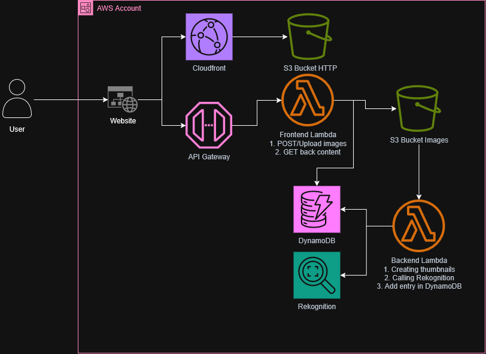

# S3 Smart Gallery

A serverless image gallery on AWS — upload photos, get AI-generated labels and captions, browse via a static website.



## Prerequisites

You need an AWS account with credentials configured locally:

```bash
aws configure
# or export AWS_ACCESS_KEY_ID, AWS_SECRET_ACCESS_KEY, AWS_DEFAULT_REGION
```

The IAM user/role needs permissions for: S3, Lambda, API Gateway, CloudFront, DynamoDB, Rekognition, IAM, and optionally Bedrock.

If using Bedrock for captions, enable the desired model in the [AWS Bedrock console](https://console.aws.amazon.com/bedrock/home#/modelaccess) before deploying.

## Deploy

```bash
cd terraform
cp terraform.tfvars.example terraform.tfvars
# edit terraform.tfvars — set upload_token and optionally caption_model_id
terraform init
terraform apply
```

After apply, Terraform outputs the website URL and API URL.

To tear down:

```bash
terraform destroy
```

> Set `force_destroy_buckets = true` in `terraform.tfvars` before destroying if you want S3 buckets deleted automatically.

## Resources Created

| Resource | Description |
|---|---|
| S3 (site bucket) | Hosts the static website (`index.html`, `config.js`) |
| S3 (images bucket) | Stores original uploads and generated thumbnails |
| CloudFront distribution | Serves the static site over HTTPS with caching |
| API Gateway (HTTP) | REST-like API for listing images and generating upload URLs |
| Lambda — api | Handles API requests: presigned S3 URLs and image listing |
| Lambda — processor | Triggered on S3 upload: resizes image, runs Rekognition/Bedrock, writes metadata to DynamoDB |
| DynamoDB table | Stores image metadata (labels, captions, S3 keys) |
| Rekognition | Detects labels in uploaded images |
| Bedrock (optional) | Generates natural-language captions if `caption_model_id` is set |
| IAM roles & policies | Least-privilege roles for each Lambda function |

## Estimated Cost

For a demo with ~100 images uploaded per month in `eu-west-1`:

| Service | Estimated cost |
|---|---|
| S3, API Gateway, DynamoDB | ~$0 (free tier / pay-per-request at low volume) |
| CloudFront | ~$0–$1 |
| Lambda | ~$0 |
| Rekognition | ~$0.10 (first 1M images/month free for 12 months) |
| Bedrock (optional) | ~$0.30–$1.50 depending on model |
| **Total** | **< $1/month without Bedrock, ~$1–$3 with Bedrock** |

Costs scale with the number of images processed and Bedrock model used. For a precise estimate use the [AWS Pricing Calculator](https://calculator.aws).

## ⚠️ Disclaimer

This project is intended for **demo and learning purposes only**. It is not production-ready and contains known issues including:

- CORS configured with `allow_origins: ["*"]` on both S3 and API Gateway
- DynamoDB Point-In-Time Recovery (PITR) is disabled
- S3 object keys from events are written to DynamoDB without input sanitisation
- No authentication or authorisation on the API beyond a shared upload token

Do not deploy this in a production environment or expose it to untrusted users.
